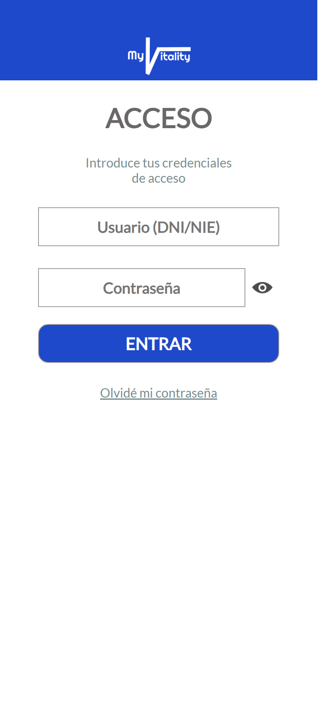
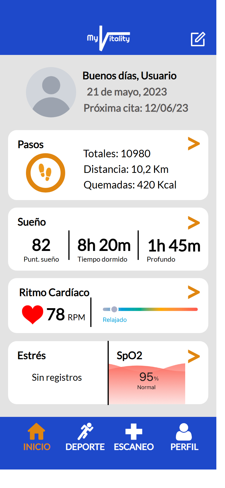
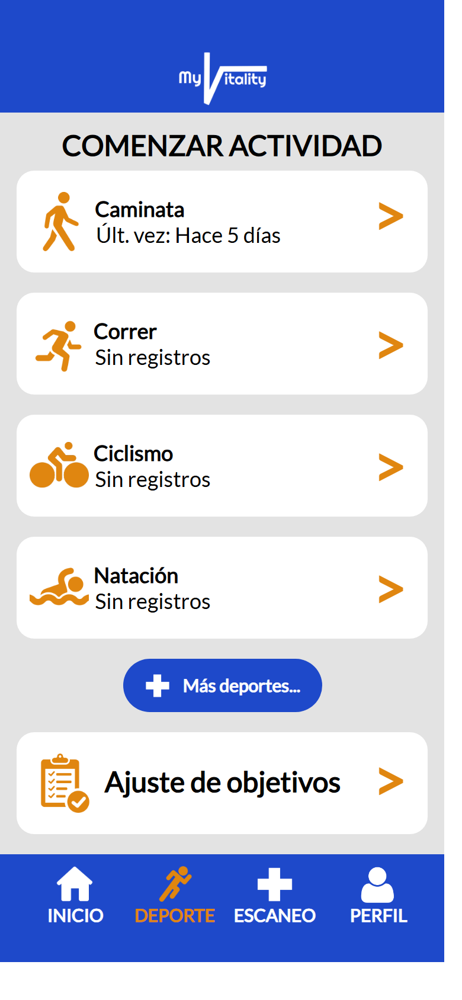
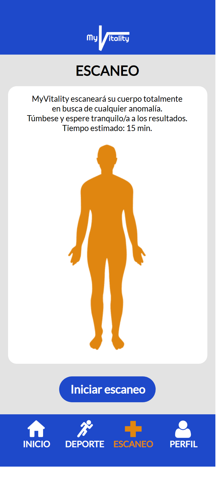
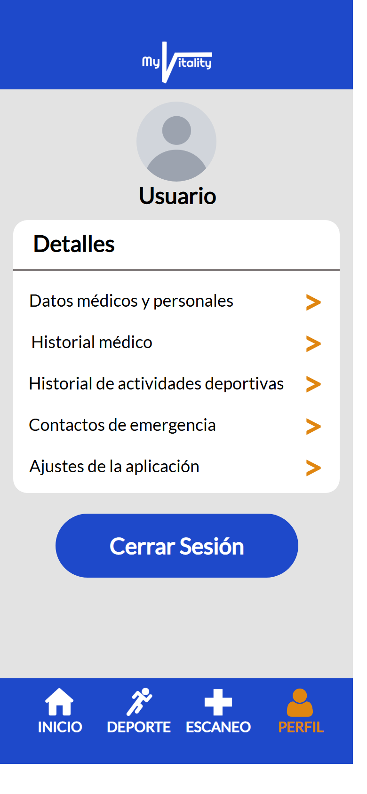

<div align="center">

# ❤️ MyVitality

**Diseño centrado en el usuario de una app de salud: desde el estudio de usuarios hasta un prototipo HTML navegable**

[]()
[]()
[]()
[]()

[Descripción](#-sobre-el-proyecto) · [Capturas](#-capturas) · [Proceso](#-el-proceso) · [Prototipo](#-el-prototipo) · [Cómo verlo](#-cómo-verlo) · [Estructura](#-estructura-del-repositorio) · [Stack](#-stack-tecnológico)

</div>

---

## 📖 Sobre el proyecto

**MyVitality** parte de una **interfaz imaginada**: un chip que se llevaría implantado en el cuerpo para vigilar la salud de forma continua y detectar cualquier anomalía, de una diabetes a un cáncer, casi en el momento en que aparece. El chip no se puede construir hoy, pero sí **la aplicación que lo acompañaría**: la que registra las constantes, muestra los resultados y avisa a urgencias si hace falta.

El trabajo recorre el proceso completo de **desarrollo centrado en el usuario** y termina en un prototipo funcional.

> 📌 **Proyecto académico** desarrollado como trabajo final de *Interacción Persona-Ordenador* (3.er curso, curso 2022-2023, Universidad de Salamanca).

---

## 🖼️ Capturas

<p align="center">
  
  
  
  
  
</p>

<p align="center"><em>Acceso · Inicio · Deporte · Escaneo · Perfil. Todos los datos son ficticios.</em></p>

---

## 🧭 El proceso

El [informe final](docs/InformeFinal_UnaiGarcia.pdf) documenta cada fase:

| Fase | Qué se hizo |
| :--- | :--- |
| **1. Exploración** | *Needfinding* (observación, análisis de la competencia y cuestionario), definición de la audiencia, escenarios de uso y encuesta de contenido. |
| **2. Conceptualización** | Flujos de proceso, mapa del sitio, *wireframes* en papel y análisis del diseño. |
| **3. Prototipo y evaluación** | Dos iteraciones de prototipado, cada una con su evaluación y conclusiones. |
| **4. Implementación funcional** | Prototipo en HTML y CSS, el que contiene este repositorio. |

---

## 📱 El prototipo

Pensado para móvil, reproduce el recorrido principal de la app:

- **Carga y acceso** con usuario (DNI/NIE) y contraseña, y recuperación de contraseña.
- **Inicio** con las constantes del día: pasos, sueño, ritmo cardíaco, estrés y saturación de oxígeno (SpO2).
- **Deporte**: caminata, correr, ciclismo y natación, y ajuste de objetivos.
- **Escaneo** corporal completo a demanda.
- **Perfil** con datos médicos, historial, contactos de emergencia y ajustes.

---

## 🚀 Cómo verlo

Abre `prototype/index.html` en el navegador (se redirige solo a la pantalla de acceso). Para ver el diseño como en un teléfono, activa el modo dispositivo de las herramientas de desarrollo con un ancho de unos 390 px.

---

## 📂 Estructura del repositorio

```
MyVitality-IPO/
├── prototype/
│   ├── index.html          # Pantalla de carga
│   ├── login.html          # Acceso
│   ├── forgotPass*.html    # Recuperación de contraseña
│   ├── inicio.html         # Constantes del día
│   ├── sport.html          # Actividades deportivas
│   ├── scan.html           # Escaneo corporal
│   ├── profile.html        # Perfil
│   ├── signOut.html        # Cierre de sesión
│   ├── css/main.css
│   └── images/             # Iconos y gráficos
└── docs/
    ├── InformeFinal_UnaiGarcia.pdf
    └── screenshots/
```

---

## 🖥️ Stack tecnológico

| Categoría | Herramientas |
| :--- | :--- |
| **Prototipo** | HTML5 · CSS3 |
| **Metodología** | Desarrollo centrado en el usuario · prototipado iterativo · evaluación con usuarios |

---

## 🎓 Qué aprendí

- Que **diseñar empieza por preguntar**: observar y encuestar antes de dibujar una sola pantalla.
- A **iterar un prototipo** a partir de la evaluación y no de la intuición.
- A llevar un diseño de *wireframe* en papel a un prototipo navegable.

---

## 📝 Notas

El avatar de perfil es una silueta genérica y los datos de salud, fechas y nombres son ficticios.

---

## 👤 Autoría

**Unai García** — Grado en Ingeniería Informática (Universidad de Salamanca)

- 🐙 GitHub: [@unaigb](https://github.com/unaigb)

---

<div align="center">

**⭐ Si este repositorio te resulta útil, considera darle una estrella.**

</div>
